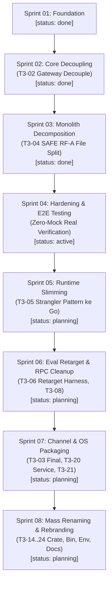

# Master Roadmap & Status Sprint Galleon Fleet

> **Single Source of Truth (SSOT):** Papan kerja `~/Apps/board/`.
> Disusun oleh **Tech Lead (Squad Lead)** mengintegrasikan seluruh konsolidasi Dev Task 3 (T3-01 s.d. T3-28), ODR baku (`standard-docs/`), dan siklus Scrum KiroCrew ⇄ agy.

---

## 1. Tabel Ringkasan Seluruh Sprint

| Sprint | Kategori | Fokus / Sprint Goal | Status | Mulai / Selesai | Referensi Tiket |
| :---: | :--- | :--- | :---: | :---: | :--- |
| **01** | Foundation | Setup board, konvensi kerja, dan sinkronisasi KiroCrew ⇄ agy | `done` | 2026-10-12 s.d. 2026-10-17 | Fondasi Board |
| **02** | Core | Dekoplasi crate Rust (T3-02 gateway lepas runtime, T3-03 channel split) | `done` | 2026-10-17 s.d. 2026-10-22 | T3-02, T3-03 |
| **03** | Refactoring | Dekomposisi file raksasa gateway >2.000 LOC (`api_config`, `ws`, `api_sections`) | `done` | 2026-10-22 s.d. 2026-10-22 | T3-04 (SAFE RF-A) |
| **04** | Hardening | **End-to-End (E2E) Testing menyeluruh (Zero-Mock Data & Real Sockets)** | `active` | 2026-10-22 (Sedang Berjalan) | US-003, BL-005, SPEC-005 |
| **05** | Refactoring | Ramping runtime per modul via strangler pattern (Go engine delegation) | `planning` | Q4 2026 | T3-05 (BR-D1) |
| **06** | Testing | Retargeting eval test harness & replay ke Go surface, hapus legacy RPC | `planning` | Q4 2026 | T3-06 (BR-D2), T3-08 |
| **07** | Integration | Finalisasi ekstraksi channel, OS service installer daemon & migration tool | `planning` | Q4 2026 | T3-03, T3-20, T3-21 |
| **08** | Rebranding | **Rename Massal: Crate `galleon-*`, Binary `galleoncode`, Env `GALLEON_*`** | `planning` | Q4 2026 | T3-14 s.d. T3-24 (ODR-16..19) |

---

## 2. Diagram Alur Dependensi Strategis

---

## 3. Rincian Eksekusi Per-Sprint

### Sprint 01 — Foundation (`status: done`)
* **Pencapaian:** Setup arsitektur board Scrum, format template front-matter (`TEMPLATES.md`), validasi skema otomatis (`validate.py`), dan otomasi bridge headless KiroCrew ⇄ agy.

### Sprint 02 — Core Decoupling (`status: done`)
* **Pencapaian:** Memutus dependensi monolitik `clawcrew-gateway` terhadap `clawcrew-runtime` (T3-02), pemisahan awal channel eksternal ke crate independen (T3-03). PR di-merge ke branch `testing`.

### Sprint 03 — Monolith Decomposition (`status: done`)
* **Pencapaian:** Dekomposisi 3 berkas produksi gateway >2.000 LOC menjadi submodul rapi (`api_config/`, `ws/`, `api_sections/`) tanpa breaking changes pada rute Axum. 444/444 test PASS. PR #72, #73, #74 MERGED.

### Sprint 04 — Hardening & E2E Testing (`status: active`)
* **Fokus:** Verifikasi ketahanan empiris lintas subsistem dengan socket TCP lokal nyata, database disk SQLite riil, signature HMAC SHA-256 asli, dan zero data mockup (kecuali fallback default values).
* **Task Aktif:**
  - `TASK-030` (`todo`): E2E Gateway REST API & WebSocket Protocol Lifecycle (Port Ephemeral `127.0.0.1:0`).
  - `TASK-031` (`blocked`): E2E Config Patch, Atomic Disk Persistence & Live Drift Detection.
  - `TASK-032` (`blocked`): E2E Channel Ingress Signature & Sandbox Outbound Egress Enforcement.
  - `TASK-033` (`blocked`): E2E Multi-Agent Session Continuity & SQLite Memory Recovery.

### Sprint 05 — Runtime Slimming / Strangler Pattern (`status: planning`)
* **Fokus:** Mengurangi ukuran dan kompleksitas `clawcrew-runtime` (T3-05 / BR-D1) dengan memindahkan logika orkestrasi turn dan session loop ke engine Go (`engine/`), menyisakan adaptor tipis di Rust.

### Sprint 06 — Eval Retargeting & RPC Deprecation (`status: planning`)
* **Fokus:** Menyesuaikan harness pengujian evaluasi trace LLM (`clawcrew-eval`, T3-06) ke surface engine Go tanpa mengubah fixture trace data, serta menghapus seluruh sisa pemanggilan legacy runtime RPC (T3-08).

### Sprint 07 — Channel Completion, OS Service & State Tooling (`status: planning`)
* **Fokus:** Ekstraksi sisa channel monolith (T3-03), CLI command `galleon service install/status/uninstall` untuk systemd user service & launchd plist non-root (T3-20), dan tooling checkpoint WAL migrasi state tanpa data loss (T3-21).

### Sprint 08 — Mass Renaming & Galleon Fleet Finalization (`status: planning`)
* **Fokus:** Rebranding menyeluruh sesuai ODR-16 s.d. ODR-19:
  1. Rename 27 crate Rust bawah-ke-atas dependency graph (`clawcrew-runtime` $\rightarrow$ `galleon-runtime` paling terakhir).
  2. Rename binary & TUI apps: `zerocode` $\rightarrow$ `galleoncode`, `zerorelay` $\rightarrow$ `galleonrelay`.
  3. Migrasi environment variables `CLAWCREW_*` $\rightarrow$ `GALLEON_*` tanpa dual-read fallback.
  4. Migrasi direktori data pengguna `~/.clawcrew` $\rightarrow$ `~/.config/galleon`.
  5. Pembersihan referensi dokumen normatif dengan **preservasi mutlak atribusi lisensi upstream ZeroClaw**.
